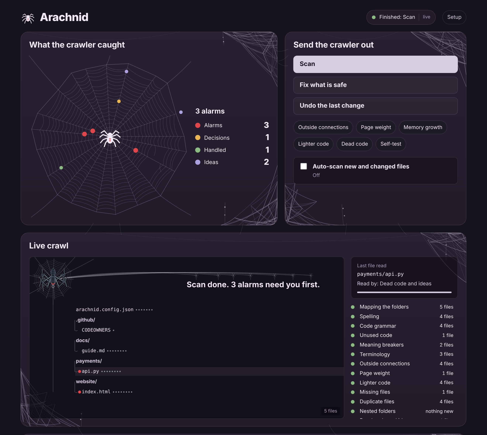
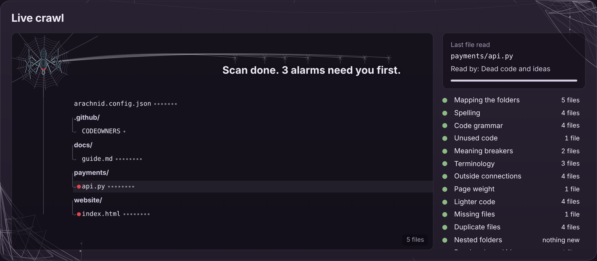
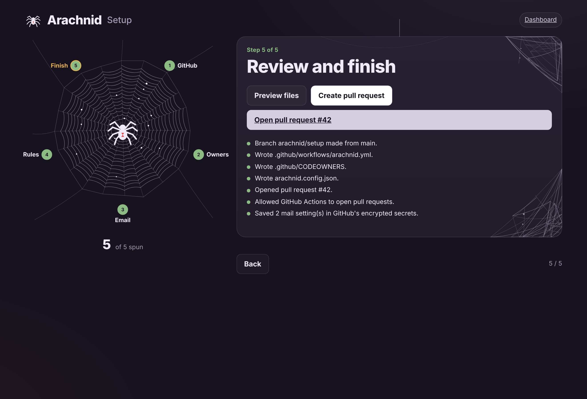

# 🕷️ Arachnid

**A spider that crawls your project, finds problems, and fixes the ones it can prove are harmless.**

It never changes how your product looks or behaves, not even by one pixel. Anything it is not sure about is left
alone and reported to you, and anything that would change your code waits for a person to approve it.

## Why use Arachnid

- **Fixes you can trust.** Every fix is first made on a copy of your project. Arachnid then opens the before and
  after versions in a real browser (at desktop and phone size) or runs your tests. If anything differs, even one
  pixel, the fix is not applied. Other tools check that the problem is gone. Arachnid also checks that your product
  is unchanged.
- **No guessing.** When there is nothing to run that could prove a fix is safe, Arachnid holds the fix back for you.
- **Nothing is lost.** Every change is backed up and can be undone byte for byte. Suggestions that change code wait
  for a person to approve them.
- **It catches what other tools skip.** Payments that never check the amount is above 0, wording mistakes, brand spellings, duplicate pictures, folders nested by
  accident, pages pointing to missing files, heavy pages, and memory that keeps growing, measured in a real browser.
- **Your code stays yours.** It runs on your computer or your own GitHub runner. No outside AI, no cloud upload. Free
  and open source (MIT).
- **The right people hear about it.** Alarms go to the owner of that folder and to the person who changed the line.
  Old problems never block someone else's pull request, and each alarm is sent once.
- **Ready in minutes.** A setup page connects your repository, teams and email, and opens one pull request with
  everything needed. Nothing reaches `main` until you merge it.
- **You can watch it work.** The live crawl shows the spider walking to each file as it is read.



---

## What it does

| | |
|---|---|
| **Finds** | broken code, hidden logic bugs that run without any error, security holes (see below), unused imports and variables, typos, wrong brand spellings (`Github` → `GitHub`), grammar that breaks meaning ("their is"), duplicate files, nested folders, missing images, scripts and styles, payments that never check the amount is above 0, leaked secrets in URLs, switched-off security checks, insecure `http://` scripts, requests without a timeout, heavy libraries, page weight, memory growth |
| **Fixes** | only what passes the **safety gate**: your project is copied, the change is made on the copy, and a real browser (or your own tests) compares before and after. Any difference means the change is held back. |
| **Asks** | before anything that is a judgement call. Lighter or faster code is offered as a suggestion that waits for your approval. |
| **Reports** | everything in one standard report, sorted as 🔴 alarms → 🟠 decisions → ✅ handled → 💡 ideas. Each item goes to the right person: the owner of that folder and whoever changed it. |
| **Undoes** | every change, byte for byte. |

It works on any language. Python, JavaScript/TypeScript, HTML/CSS, JSON and Markdown get the deepest checks, and the
dependency files of npm, pip, Maven, Gradle, Go, Cargo, Composer, Bundler, NuGet, pub and SwiftPM are understood too.

### Hidden bugs it hunts

Code that runs without a single error and still does the wrong thing. These are reported for a person to decide,
never changed automatically. Each rule was tested on millions of lines of professional code so that it almost never
complains about correct code. (It found real bugs in matplotlib, scikit-learn, mermaid and Chrome's own tools.)

| Language | Examples |
|---|---|
| **Python** | `if x == "a" or "b"` (always true) · `items = items.sort()` (None) · `name.strip()` (result thrown away) · `"Hello {name}"` without `f` · `range(len(x) + 1)` · a `while` loop whose variable never changes · `int(input())` that crashes on letters · a default like `when=datetime.now()` that never updates · an error created but not raised · a grade function that returns nothing for low scores |
| **JavaScript / TypeScript** | `if (x = 5)` · `x === NaN` · `typeof x === "numbr"` · `return` with the value on the next line · `fetch()` used without `await` · `forEach(async ...)` · `useEffect(async ...)` · `onClick={handle()}` · `i <= list.length` · `.lenght`, `innerHtml` · `getElementById("#menu")` · `new Date(2024, 12, 1)` · a duplicate `case` |
| **HTML** | the same id twice · a `<label>` for a missing id · a quantity or price field that accepts negative numbers · a button that submits the form by accident · `type="emial"` · a script with a misspelled type · a script looking for an element no page has · `onclick` calling a function that does not exist |
| **HTML the browser quietly rewrites** | a `<div>`, list or table inside a `<p>` (the browser ends the paragraph early) · a link inside a link · a form inside a form · a button inside a button · `<div />` (stays open and swallows the rest) · text put directly inside `<table>` (moved above it) · an attribute quote that never closes · a stray `>` or `"` shown on the page · `&nbps;` (shown literally) · `&copy2024` (shown as ©2024) · CSS or scripts using `table > tr` (never matches) |
| **HTML forms, attributes and text** | `disabled="false"` (still disabled) · `data-userId` read as `dataset.userId` (undefined) · a file upload form without `multipart/form-data` (sends only the name) · form fields without `name` (never sent) · `title="Click "Here""` · `</br>` (an extra line break) · a `<div>` inside `<head>` (the rest of the head lands in the body) · garbled text like `’` from a wrong encoding · ideas: missing `<meta charset>`, non-`<li>` inside a list, h1 jumping to h4, `aria-hidden` on something clickable, `<base>` |
| **Pages, forms and scripts together** | a comment ended with `-- >` (hides the rest) · `media="pritn"` · `&amp;copy;` · links to missing pages and `#anchors` · `www.site.com` without https:// · `C:\Users\...` paths · `method="POTS"`, `type="buton"` (becomes submit) · `min` bigger than `max` · radio names `shipping` / `Shipping` · two `selected` options · `form="..."` pointing nowhere · a field named `submit` breaking `form.submit()` · `onclick` calling a function inside a module · `.value` on a `<span>` · a checkbox tested with `.value` · `499 + input.value` = `"4991"` · objects saved to `localStorage` · `r.json` without `()` · `transition: 0.3` without `s` |
| **File paths** | `img/Logo.PNG` when the file is `logo.png`: works on Windows and Mac, 404 on a Linux web server |
| **CSS** | misspelled properties (`widht`, `colr`) and values (`display: flexx`, `text-align: centre`) · impossible colours (`#ggg`) · sizes and times without units (`width: 100`, `transition: 0.3`) · units that do not exist (`10pxx`, `10 px`) · `var(--brand-colour)` when only `--brand-color` exists · `@media (max-width: 768)` without a unit · `calc(100%-2rem)` without spaces · `//` comments (CSS has none - the next rule dies) · a missing `;` · `@import` after other rules · a `{` never closed · also inside `<style>` blocks |
| **JSON** | the same key twice · `package.json` starting a file that does not exist |
| **Markdown** | links and pictures to missing files · links to headings that do not exist · a code block that never closes · `#Heading` without a space |

### Page health (opens your pages in a real browser)

What you would see with DevTools open on every page, done for you: JavaScript errors while a page loads (with the
file and line), errors written to the console, and pictures, styles, scripts or fonts that answer 404. It also
MEASURES the layout: a page wider than the screen (with the element that sticks out, at phone and desktop width),
`position: sticky` that can never stick, text in the same colour as its background, text too light to read, and
`z-index` that does nothing (pointing at the CSS line). Built projects
(Vite, React, ...) are built in a temporary copy first. Errors on pages that need your backend, or a permission the
test browser does not give (location, camera), are marked as ideas instead of decisions. To switch it off: `"pagecheck": false` in
`arachnid.config.json`, or `ARACHNID_NO_BROWSER=1`.

**Brutal test:** a shop website with 38 bugs hidden deep in its HTML, forms, scripts and styles - Arachnid finds
all 38 on their exact lines, and reports nothing at all on the same site with the bugs fixed.
The **brutal CSS test** does the same with 30 CSS bugs (from `var(--brand-colour)` to a sticky header trapped by
`overflow: hidden`): 30 of 30 found, nothing on the clean twin.

Tested on about 2,200 real pages from Google Chrome's and MDN's sample sites: every new HTML finding was a real
bug (for example a `<ul>` inside a `<p>` and `<a>` typed where `</a>` was meant), with **zero** false alarms.

### Security

Arachnid reads your code the way an attacker would. Everything runs on your computer; only one optional check talks
to the internet, and it sends nothing but library names and versions.

| Check | What it finds |
|---|---|
| **Injection** | visitor input inside a database query (SQL and NoSQL), a shell command, `eval` / `new Function`, or a page template |
| **XSS** | text put into the page as HTML: `innerHTML`, `dangerouslySetInnerHTML`, `v-html`, `document.write`, Angular `bypassSecurityTrustHtml`, templates that print without escaping (`{{ x\|safe }}`, EJS `<%- %>`, `{{{ }}}`, `autoescape: false`) |
| **Secrets** | real-looking keys (AWS, GitHub, Stripe, OpenAI, Anthropic, Google, Slack, private keys ...), passwords written in code, a committed `.env` file |
| **XXE and ReDoS** | XML readers that load outside files (`noent: true`, external entities); text patterns like `([0-9]+)+` that freeze the server on a crafted input |
| **Broken trust** | login tokens accepted without checking the signature, passwords stored with md5/sha, guessable reset codes (`random`, `Math.random`), files, redirects and server requests chosen by the visitor, whole-request records (`User.create(req.body)`), debug mode, CSRF switched off, tokens in `localStorage` |
| **Open API routes** | routes that create, change or delete data with no visible login check, in Express, Next.js, Flask, FastAPI and Django REST framework |
| **Libraries with known holes** | every exact library version from your lock files, looked up in the free [OSV](https://osv.dev) database (npm, PyPI, Go, Cargo, RubyGems, Composer, Maven, NuGet, Pub), with the version to update to |

An **alarm** means the danger is clear (visitor input flows straight into a query, a real key is in the code, a
critical hole in a library you list). The rest are **decisions** for a person.

**Tested on real vulnerable apps:** the six training apps security teams use - OWASP NodeGoat, OWASP Juice Shop,
DVNA, PyGoat, DVPWA and Vulpy. Arachnid found **42 of their 44 documented code-level holes**. And on about 23,000
files of professional code it raised **zero** false alarms. To keep the library lookup off: `"vulncheck": false` in
`arachnid.config.json`, or `ARACHNID_OFFLINE=1`.

What it cannot do: it reads code, it does not attack your running app, and it cannot know your business rules (who
may see whose data). For an app that handles money or personal data, it does not replace a professional security review.

### Shorter code, the same product (slim)

AI assistants often write ten lines where three do the same. `python arachnid.py slim` finds those places and offers
the shorter version - **only when it can prove the program stays exactly the same**:

- **Python:** every rewrite is one of a small set of rules whose sameness is known (`if x: return True / else:
  return False`, a loop that only appends, a search loop that becomes `any()` / `all()`, a value stored only to be
  returned ...), and the new file must reduce to exactly the same "canonical" program as the old one.
- **JavaScript / TypeScript:** esbuild must read the old and the new file as the same program.
- **Never touched, on purpose:** code with your comment in it, lines that would become hard to read, test files, and
  every trap that only LOOKS shorter: `sum()` of decimals (since Python 3.12 it adds more precisely than a loop),
  `x or default` (wrong for `0` and `""`), reading a getter twice, a dropped `await`, a loop inside `try` or
  `with suppress(...)`, a loop variable used after the loop.

Nothing changes until you approve: `python arachnid.py approve <id>`, then `python arachnid.py apply-approved` checks
the proof again before a file is touched (`undo` puts it back).

**With an AI:** `python arachnid.py slim --ai` sends long functions to an AI together with the
[Ponytail](https://github.com/DietrichGebert/ponytail) rules ("the smallest correct solution"). Arachnid never
trusts the answer. Each one is either **proven** the same program, or **tested side by side**: the old and the new
function run on hundreds of inputs and must give identical results, result types, errors, printed output and changes
to the inputs - with at least 90% of the lines of both versions actually run. Everything else is thrown away. Set
`ARACHNID_AI_CMD` (any AI command line, for example `claude -p`) or `ANTHROPIC_API_KEY`; the key is never stored.

**Tested on real libraries:** every proven shorter version Arachnid found was applied to six popular Python libraries
(click, boltons, more-itertools, sqlparse, cachetools, toolz - 186 edits, about 280 lines shorter) and to
validator.js; each library's own test suite - about 5,500 tests - gives exactly the same result as before.

## Get started

There are three ways to use Arachnid. Pick the one that fits you; they can be combined.

| | What it is | You need |
|---|---|---|
| **A. On GitHub** | A guard that checks every pull request by itself | Only a GitHub repository |
| **B. On your computer (Docker)** | Scan, fix, undo and the dashboard, without installing Python | [Docker Desktop](https://www.docker.com/products/docker-desktop/) |
| **C. On your computer (Python)** | The same as B, run straight from the source code | Python 3.10 or newer |

### A. On GitHub (about 5 minutes, nothing to install)

1. **Check your branch name.** Open your repository on github.com. The branch button near the top left should say
   **main**. If it says **master**, then after pasting in step 5 change these four places to `master`:
   `branches: [main]` (twice), `refs/heads/main` and `--base main`. Leave `ARACHNID_REF: main` as it is (that is
   Arachnid's own branch). The Setup page does this for you automatically.
2. **Copy the Arachnid file.** Open [`github/arachnid.yml`](github/arachnid.yml) and click **Copy raw file**
   (the two-squares icon, top right of the file).
3. **Go to YOUR project's repository** (the one you want checked, not this one). Click **Add file → Create new file**.
4. **Name the file.** In the small **"Name your file..."** box at the top (not the big box), type
   `.github/workflows/arachnid.yml`. Each `/` creates a folder.
5. **Paste.** Click inside the big empty box and press **Ctrl + V**.
6. **Save it as a pull request.** Click **Commit changes... → Create a new branch for this commit and start a pull
   request → Propose changes → Create pull request**.
7. **Watch it run.** At the bottom of the pull request, the **Arachnid check** runs for 2 to 5 minutes. When it turns
   green, Arachnid has written a comment listing what it found.
8. **Merge.** Click **Merge pull request → Confirm merge**. From now on every pull request is checked automatically.
9. *(Optional)* To let Arachnid offer safe fixes as a pull request: **Settings → Actions → General → Workflow
   permissions →** tick **Allow GitHub Actions to create and approve pull requests → Save**.

Working in a team? The **Setup page** (part of the dashboard, see B or C) does all of this for you **and** sets up
folder owners, team e-mails and rules, in one pull request.

### B. On your computer with Docker (no Python needed)

1. **Install [Docker Desktop](https://www.docker.com/products/docker-desktop/)**, open it, and wait until it says
   **Engine running**.
2. **Have your project on your computer.** If it is only on GitHub: on its page click **Code → Download ZIP** and
   unzip it (or `git clone` it).
3. **Open a terminal.** On Windows: press the Windows key, type `cmd`, press Enter. On Mac: open **Terminal**.
4. **Run one of these**, with the path changed to your project folder. The first run downloads Arachnid (a few
   minutes); after that it starts in seconds.

   Look only (changes nothing):
   ```bash
   docker run --rm -it -v "C:\path\to\your\project:/project" ghcr.io/meetraval09/arachnid scan
   ```
   Open the dashboard (and the Setup page):
   ```bash
   docker run --rm -it -p 127.0.0.1:8765:8765 -v "C:\path\to\your\project:/project" ghcr.io/meetraval09/arachnid dashboard
   ```
   then open **http://127.0.0.1:8765** in your browser. Press **Ctrl + C** in the terminal to stop it.

**Shorter commands (recommended if you also want fix and undo).** Download [`arachnid.cmd`](arachnid.cmd) (Windows)
or [`arachnid.sh`](arachnid.sh) (Mac, Linux): open the file, click **Download raw file**, and put it in a folder you
can find. Then, in a terminal opened in that folder:

```bash
arachnid scan      "C:\path\to\your\project"   # look only - changes nothing
arachnid fix       "C:\path\to\your\project"   # fix what is provably safe (backed up first)
arachnid undo      "C:\path\to\your\project"   # put the last fix back
arachnid dashboard "C:\path\to\your\project"   # then open http://127.0.0.1:8765
arachnid update                                # get the newest Arachnid
```

On Mac and Linux it is `./arachnid.sh scan ~/code/my-project`. The helper keeps each project's results and undo
backups between runs, so `undo` still works the next day.

Your project never leaves your computer: Docker only lends the folder to Arachnid, and the dashboard can only be
opened from your own computer. On the Setup page, sign in with **Use a token** (the page links to where GitHub
creates one).

### C. On your computer with Python

1. **Install Python 3.10 or newer** from [python.org](https://www.python.org/downloads/) (on Windows, tick
   **Add python.exe to PATH** in the installer).
2. **Get Arachnid and its optional extras** (in a terminal):
   ```bash
   git clone https://github.com/meetRaval09/arachnid.git
   cd arachnid
   pip install -r requirements.txt
   python -m playwright install chromium
   ```
   (No git? On this page click **Code → Download ZIP**, unzip it, and open the terminal inside that folder.)
3. **Open the dashboard** for your project:
   ```bash
   python dashboard.py "C:\path\to\your\project"
   ```
   It opens in your browser by itself. Press **Ctrl + C** in the terminal to stop it.

Or use it straight from the command line:

```bash
python arachnid.py scan  "C:\path\to\your\project"   # look only - changes nothing
python arachnid.py fix   "C:\path\to\your\project"   # fix what is provably safe (backed up first)
python arachnid.py undo                               # put the last fix back (repeat to go further back)
python arachnid.py selftest                           # prove the whole chain works on this computer
```

## The dashboard

The dashboard (`arachnid dashboard`, or `python dashboard.py <project>`) is a control room in your browser. It runs only on your computer, at
`http://127.0.0.1:8765`.

- **Send the crawler out:** Scan, Fix what is safe, Undo, and the extra checks (outside connections, page weight,
  memory growth, lighter code, dead code).
- **What the crawler caught:** every finding is a drop on a spider web. The closer it is to the spider, the more urgent.
- **Live crawl:** the spider walks your file tree to each file at the moment a check opens it. When the job is done it
  climbs back to its web and spins the result into words.
- **Auto-scan:** add or change a file, and a scan starts by itself. Scans only read.
- **Suggestions:** approve or reject them. Approved ones still pass the safety gate.
- **On GitHub:** the project's Arachnid runs. You can see which step a running check is on, and replay a finished run's walk.



## Setup for a team (dashboard → Setup)

A five-step page that connects a repository and writes everything a team needs:

1. **GitHub:** sign in and choose the repository.
2. **Owners:** give folders to teams or people. This becomes `.github/CODEOWNERS`.
3. **Email:** one inbox for everyone or one per team; pick the mail provider; send a test email.
4. **Rules:** who gets alarms, who gets decisions.
5. **Finish:** one pull request with the workflow, CODEOWNERS and settings. The mail password goes into GitHub's
   encrypted secrets.



## On GitHub, automatically

Add [`github/arachnid.yml`](github/arachnid.yml) to your project as `.github/workflows/arachnid.yml` (step by step:
[Get started, A](#a-on-github-about-5-minutes-nothing-to-install)), or let the Setup page do it.

- **Pull request into main:** Arachnid checks the change first and writes one comment. A critical problem in a file
  that pull request changes turns the check red. Problems that were already in main are listed, but they do not block
  the merge.
- **Push into main:** a backup check. Alarms open (and later close) one "Arachnid alarm" issue. Safe fixes are offered
  as a pull request, `arachnid/auto-fixes`.
- **Alarms reach the right people:** GitHub @mentions, and team emails through your own mail server. Each alarm is
  sent once, not on every push.

## Promises

- Nothing reaches `main` without a person merging it. Nothing is ever pushed to main.
- No change is applied unless the safety gate proves the product is unchanged. If nothing can be run to prove it, the
  change is held back.
- Suggestions that change code wait for human approval.
- Every change is backed up and can be undone.
- Reports and emails contain file names, line numbers and short descriptions only. They never contain your code, and
  secrets are masked.
- GitHub logins stay in memory. Mail passwords live in GitHub's encrypted secrets, never in a file.

## Tests

```bash
python arachnid.py selftest   # the whole chain: repair, safety gate, alarms, approvals, undo
python qa_accuracy.py         # 30 planted problems must be found, 20 clean look-alikes must stay quiet
python qa_html_brutal.py      # a shop website with 38 deeply hidden bugs: all must be found, its clean twin must get 0 findings
python qa_css_brutal.py       # a studio website with 30 deeply hidden CSS bugs: all must be found, its clean twin must get 0 findings
python qa_slim_brutal.py      # shorter code: 22 proven shorter versions found, 15 traps untouched, old and new code behave identically, wrong AI answers stopped
python qa_stress.py           # 15 kinds of projects: unicode names, 1500 files, symlink loops, CRLF, ...
```

The same tests run on every push (`.github/workflows/tests.yml`, a copy is in `github/tests.yml`).
The Docker image is built, tested (the same self-test and accuracy test, inside the image) and published by
`.github/workflows/docker.yml` (a copy is in `github/docker.yml`).

## Learn more

[docs/GUIDE.md](docs/GUIDE.md) explains every check, every setting and every command in plain words.

## Licence

MIT, see [LICENSE](LICENSE). The bundled spell checker is
[pyspellchecker](https://github.com/barrust/pyspellchecker) by Tyler Barrus (MIT, see `vendor/LICENSE-pyspellchecker.txt`).
The AI instructions in `ai/ponytail/` are [Ponytail](https://github.com/DietrichGebert/ponytail) by DietrichGebert (MIT,
see `ai/ponytail/LICENSE`).
