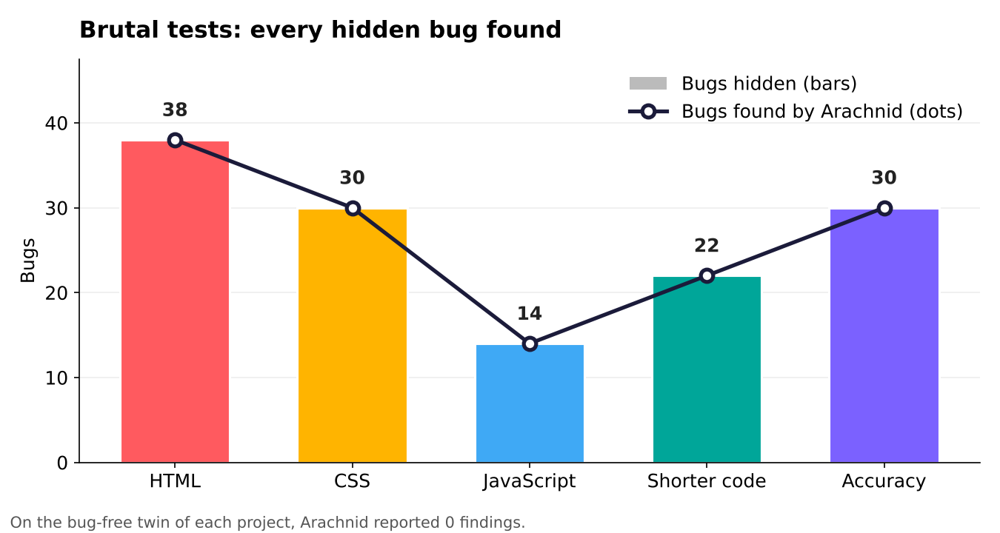
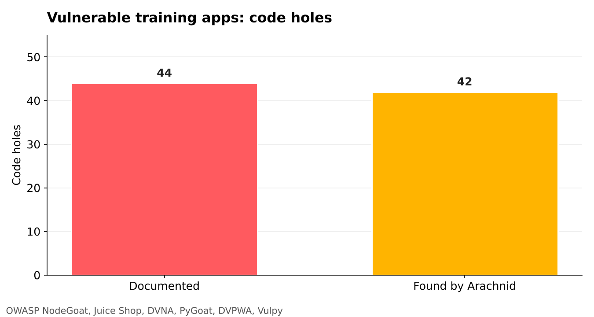
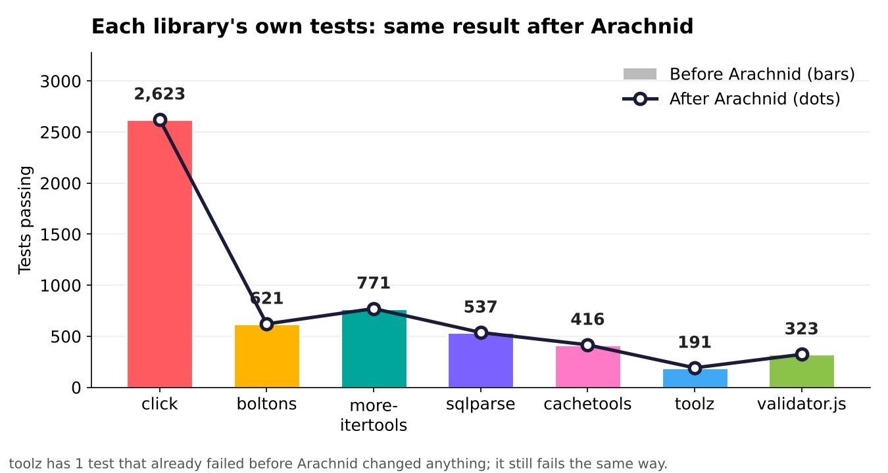
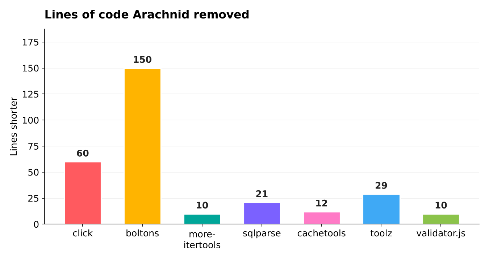

# 🕷️ Arachnid

[](https://github.com/meetRaval09/arachnid/actions/workflows/tests.yml)
[](https://github.com/meetRaval09/arachnid/actions/workflows/docker.yml)
[](LICENSE)

**A spider that crawls your project, finds the bugs nothing else notices, and fixes only what it can PROVE is harmless.**

It never changes how your product looks or behaves, not even by one pixel. Anything it cannot prove is held back and
reported to you, and anything that changes your code waits for a person to approve it.

## The proof, in numbers

Every number below comes from a test you can run yourself (the command is in the last column). The brutal tests run
again on every push, so if Arachnid ever gets worse, the badge above turns red.

| What was tested | Result | Run it |
|---|---|---|
| A shop website with **38 bugs hidden** in its HTML, forms, scripts and styles | **38 / 38** found on the exact line · **0** findings on the same site with the bugs fixed | `python qa_html_brutal.py` |
| A studio website with **30 hidden CSS bugs** | **30 / 30** found · **0** on the clean twin | `python qa_css_brutal.py` |
| A shop's JavaScript with **14 debugging leftovers** (`debugger;`, swallowed errors, errors thrown as text, timers never stopped, `console.log("here")`) | **14 / 14** found · **0** on the clean twin | `python qa_js_brutal.py` |
| AI-style long code, plus **15 traps** that only *look* shorter | **22 / 22** shorter versions found · **0** traps touched · **0** behaviour differences in 447 side-by-side calls | `python qa_slim_brutal.py` |
| **30 planted problems** and **20 correct look-alikes**, across languages | **30 / 30** found · **0** false complaints | `python qa_accuracy.py` |
| A change that moves a picture by **one pixel** | caught - the fix is **not** applied | `python arachnid.py selftest` |
| Six intentionally vulnerable training apps (OWASP NodeGoat, Juice Shop, DVNA, PyGoat, DVPWA, Vulpy) | **42 / 44** documented code holes found | see [Security](#security) |
| Arachnid's shorter code applied to **7 real libraries** (click, boltons, more-itertools, sqlparse, cachetools, toolz, validator.js) | **~5,500** of their own tests: **exactly the same result** as before | see [Proof](#proof-what-arachnid-did-on-real-code) |
| About **2,250 real web pages** and **2,900 real CSS files** (Google Chrome and MDN samples, installed packages) | every new HTML/CSS decision was a **real bug** · **0** false alarms | see [Proof](#proof-what-arachnid-did-on-real-code) |



The dots sit exactly on top of the bars: every hidden bug was found. On the bug-free twin of each test project,
Arachnid reported **zero** findings.

### What is a "brutal test"?

Think of it like a teacher hiding mistakes in an exam paper, then checking whether the student finds every one,
**and** giving the student a perfect paper to see whether they wrongly mark anything as a mistake.

Each brutal test is a small, made-up project with bugs hidden on purpose, so deep that the page still opens and
nothing shows an error. Every brutal test also has a **clean twin**: the same project with every bug fixed, plus
correct code that *looks* like the bugs. A test passes only if Arachnid finds **every** bug on its exact line,
and finds **nothing at all** on the clean twin.

| Test | The made-up project | A few of the hidden bugs |
|---|---|---|
| **HTML** (38 bugs) | a small shop: 3 pages, 2 scripts, 1 style sheet | a comment written `-- >` instead of `-->`, so the whole product list silently disappears · two radio buttons named `shipping` and `Shipping`, so both can be picked · `499 + "1"` giving `"4991"` instead of `500` · a form sent with `method="POTS"` · a picture loaded from `C:\Users\...` that works only on the developer's own laptop |
| **CSS** (30 bugs) | a studio site: 1 page, 4 style sheets | `var(--brand-colour)` when the variable is spelled `--brand-color` · `@media (max-width: 768)` with no `px`, so the phone layout never turns on · `calc(100%-2rem)` with no spaces, which browsers ignore · `text-align: centre` · white text on a white background · a banner wider than a phone screen |
| **Shorter code** (22 + 15 traps) | a small project written the long, AI-style way in Python, JavaScript and TypeScript | 22 places that really can be shorter, and 15 **traps** that only *look* like they can - for example, a loop of decimal numbers, which `sum()` would add slightly differently. Arachnid must shorten the 22, leave all 15 traps alone, and the old and new code must give exactly the same answers when run side by side |
| **JavaScript leftovers** (14) | a small shop: a page with an inline script, 2 scripts, a React component, a TypeScript file | a `debugger;` that freezes the page for anyone with developer tools open · an empty `catch {}` that hides a broken saved cart · `throw "Item id is missing"` (text, not an Error, so no record of where it happened) · `console.time("total")` ended as `console.timeEnd("Total")` · a `console.group()` never closed · `console.log("got here!!")`. The clean twin is full of look-alikes that must stay quiet: `options.debugger = true`, a `catch` with a comment explaining it, `throw new Error(...)`, real log messages, a test file and a command-line tool that are allowed to log |
| **Accuracy** (30 + 20 look-alikes) | small files in several languages | 30 planted problems that must be found, and 20 pieces of correct code that look wrong, where Arachnid must stay quiet |

**Security test.** Six apps that security teams build *on purpose* with known holes, to train people. Their
authors list every hole, so we can count exactly how many Arachnid finds:



## How it decides

1. **Scan.** About 25 checks read every file.
2. **Sort.** Each finding becomes 🔴 an alarm (clear danger), 🟠 a decision (a real bug, you choose the fix) or 💡 an idea.
3. **Safety gate.** A fix is made on a copy first. It is applied only if it is provably the same program, or if the
   pages look identical in a real browser (desktop and phone, every pixel) or the build and the project's own tests
   give the same result. Anything else is held back for you. No switch turns the gate off, and it fails closed.
4. **Undo.** Every applied change is backed up and can be undone byte for byte.

## Why use Arachnid

- **Fixes you can trust.** Other tools check that the problem is gone. Arachnid also checks that your product is
  unchanged, down to the pixel, and holds back anything it cannot prove.
- **It catches what other tools skip.** Code that runs without a single error and still does the wrong thing: a
  checkout that accepts a total of ₹0, `499 + input.value` giving `"4991"`, a `<div>` the browser quietly moves out
  of a paragraph, a CSS variable that does not exist, a page wider than a phone.
- **Nothing is lost.** Every change is backed up and can be undone byte for byte.
- **Your code stays yours.** It runs on your computer or your own GitHub runner. Nothing is uploaded. The only
  outside calls are optional: a library-version lookup, and the AI mode (`slim --ai`), which sends code to the AI
  only when you switch it on with your own key. Free and open source (MIT).
- **The right people hear about it.** Alarms go to the owner of that folder and to the person who changed the line,
  once. Old problems never block someone else's pull request.
- **Ready in minutes.** A setup page opens one pull request with everything needed. Nothing reaches `main` until you merge it.


---

## What it does

| | |
|---|---|
| **Finds** | hidden logic bugs, broken code, security holes, HTML the browser quietly rewrites, CSS the browser silently ignores, layout problems measured in a real browser, typos and brand spellings, duplicate and missing files, payments that never check the amount, leaked secrets, heavy pages, memory growth |
| **Fixes** | only what passes the **safety gate** (above) |
| **Shortens** | long, AI-style code into shorter code that is **proven** to be the same program ([slim](#shorter-code-the-same-product-slim)) |
| **Asks** | before anything that is a judgement call: suggestions wait for your approval |
| **Reports** | 🔴 alarms → 🟠 decisions → ✅ handled → 💡 ideas, each to the right person |
| **Undoes** | every change, byte for byte |

It works on any language. Python, JavaScript/TypeScript, HTML/CSS, JSON and Markdown get the deepest checks, and the
dependency files of npm, pip, Maven, Gradle, Go, Cargo, Composer, Bundler, NuGet, pub and SwiftPM are understood too.

### Hidden bugs it hunts

Code that runs without a single error and still does the wrong thing. These are reported for a person to decide,
never changed automatically. Each rule was tested on millions of lines of professional code so that it almost never
complains about correct code. (It found real bugs in matplotlib, scikit-learn, mermaid and Chrome's own tools.)

| Language | Examples |
|---|---|
| **Python** | `if x == "a" or "b"` (always true) · `items = items.sort()` (None) · `name.strip()` (result thrown away) · `"Hello {name}"` without `f` · `range(len(x) + 1)` · a `while` loop whose variable never changes · `int(input())` that crashes on letters · a default like `when=datetime.now()` that never updates · an error created but not raised · a grade function that returns nothing for low scores |
| **JavaScript / TypeScript** | `if (x = 5)` · `x === NaN` · `typeof x === "numbr"` · `return` with the value on the next line · `fetch()` used without `await` · `forEach(async ...)` · `useEffect(async ...)` · `onClick={handle()}` · `i <= list.length` · `.lenght`, `innerHtml` · `getElementById("#menu")` · `new Date(2024, 12, 1)` · a duplicate `case` |
| **JavaScript debugging leftovers** | a `debugger;` left in the code (freezes the page for anyone with developer tools open) · an empty `catch {}` that hides errors · `throw "text"` instead of `throw new Error(...)` · `console.time()` with no matching `timeEnd()`, a `console.group()` never closed · ideas: `console.log("here")`-style lines left in page code |
| **HTML** | the same id twice · a `<label>` for a missing id · a quantity or price field that accepts negative numbers · a button that submits the form by accident · `type="emial"` · a script with a misspelled type · a script looking for an element no page has · `onclick` calling a function that does not exist |
| **HTML the browser quietly rewrites** | a `<div>`, list or table inside a `<p>` (the browser ends the paragraph early) · a link inside a link · a form inside a form · a button inside a button · `<div />` (stays open and swallows the rest) · text put directly inside `<table>` (moved above it) · an attribute quote that never closes · a stray `>` or `"` shown on the page · `&nbps;` (shown literally) · `&copy2024` (shown as ©2024) · CSS or scripts using `table > tr` (never matches) |
| **HTML forms, attributes and text** | `disabled="false"` (still disabled) · `data-userId` read as `dataset.userId` (undefined) · a file upload form without `multipart/form-data` (sends only the name) · form fields without `name` (never sent) · `title="Click "Here""` · `</br>` (an extra line break) · a `<div>` inside `<head>` (the rest of the head lands in the body) · garbled text like `’` from a wrong encoding · ideas: missing `<meta charset>`, non-`<li>` inside a list, h1 jumping to h4, `aria-hidden` on something clickable, `<base>` |
| **Pages, forms and scripts together** | a comment ended with `-- >` (hides the rest) · `media="pritn"` · `&amp;copy;` · links to missing pages and `#anchors` · `www.site.com` without https:// · `C:\Users\...` paths · `method="POTS"`, `type="buton"` (becomes submit) · `min` bigger than `max` · radio names `shipping` / `Shipping` · two `selected` options · `form="..."` pointing nowhere · a field named `submit` breaking `form.submit()` · `onclick` calling a function inside a module · `.value` on a `<span>` · a checkbox tested with `.value` · `499 + input.value` = `"4991"` · objects saved to `localStorage` · `r.json` without `()` · `transition: 0.3` without `s` |
| **File paths** | `img/Logo.PNG` when the file is `logo.png`: works on Windows and Mac, 404 on a Linux web server |
| **CSS** | misspelled properties (`widht`, `colr`) and values (`display: flexx`, `text-align: centre`) · impossible colours (`#ggg`) · sizes and times without units (`width: 100`, `transition: 0.3`) · units that do not exist (`10pxx`, `10 px`) · `var(--brand-colour)` when only `--brand-color` exists · `@media (max-width: 768)` without a unit · `calc(100%-2rem)` without spaces · `//` comments (CSS has none - the next rule dies) · a missing `;` · `@import` after other rules · a `{` never closed · also inside `<style>` blocks |
| **JSON** | the same key twice · `package.json` starting a file that does not exist |
| **Markdown** | links and pictures to missing files · links to headings that do not exist · a code block that never closes · `#Heading` without a space |

### Page health (opens your pages in a real browser)

What you would see with DevTools open on every page, done for you: JavaScript errors while a page loads (with the
file and line), errors written to the console, and pictures, styles, scripts or fonts that answer 404. It also
MEASURES the layout: a page wider than the screen (with the element that sticks out, at phone and desktop width),
`position: sticky` that can never stick, text in the same colour as its background, text too light to read, and
`z-index` that does nothing (pointing at the CSS line). Built projects
(Vite, React, ...) are built in a temporary copy first. Errors on pages that need your backend, or a permission the
test browser does not give (location, camera), are marked as ideas instead of decisions. To switch it off: `"pagecheck": false` in
`arachnid.config.json`, or `ARACHNID_NO_BROWSER=1`.

### Security

Arachnid reads your code the way an attacker would. Everything runs on your computer; only one optional check talks
to the internet, and it sends nothing but library names and versions.

| Check | What it finds |
|---|---|
| **Injection** | visitor input inside a database query (SQL and NoSQL), a shell command, `eval` / `new Function`, or a page template |
| **XSS** | text put into the page as HTML: `innerHTML`, `dangerouslySetInnerHTML`, `v-html`, `document.write`, Angular `bypassSecurityTrustHtml`, templates that print without escaping (`{{ x\|safe }}`, EJS `<%- %>`, `{{{ }}}`, `autoescape: false`) |
| **Secrets** | real-looking keys (AWS, GitHub, Stripe, OpenAI, Anthropic, Google, Slack, private keys ...), passwords written in code, a committed `.env` file |
| **XXE and ReDoS** | XML readers that load outside files (`noent: true`, external entities); text patterns like `([0-9]+)+` that freeze the server on a crafted input |
| **Broken trust** | login tokens accepted without checking the signature, passwords stored with md5/sha, guessable reset codes (`random`, `Math.random`), files, redirects and server requests chosen by the visitor, whole-request records (`User.create(req.body)`), debug mode, CSRF switched off, tokens in `localStorage` |
| **Open API routes** | routes that create, change or delete data with no visible login check, in Express, Next.js, Flask, FastAPI and Django REST framework |
| **Libraries with known holes** | every exact library version from your lock files, looked up in the free [OSV](https://osv.dev) database (npm, PyPI, Go, Cargo, RubyGems, Composer, Maven, NuGet, Pub), with the version to update to |

An **alarm** means the danger is clear (visitor input flows straight into a query, a real key is in the code, a
critical hole in a library you list). The rest are **decisions** for a person.

**Tested on real vulnerable apps:** the six training apps security teams use - OWASP NodeGoat, OWASP Juice Shop,
DVNA, PyGoat, DVPWA and Vulpy. Arachnid found **42 of their 44 documented code-level holes**. And on about 23,000
files of professional code it raised **zero** false alarms. To keep the library lookup off: `"vulncheck": false` in
`arachnid.config.json`, or `ARACHNID_OFFLINE=1`.

What it cannot do: it reads code, it does not attack your running app, and it cannot know your business rules (who
may see whose data). For an app that handles money or personal data, it does not replace a professional security review.

### Shorter code, the same product (slim)

AI assistants often write ten lines where three do the same. `python arachnid.py slim` finds those places and offers
the shorter version - **only when it can prove the program stays exactly the same**:

- **Python:** every rewrite is one of a small set of rules whose sameness is known (`if x: return True / else:
  return False`, a loop that only appends, a search loop that becomes `any()` / `all()`, a value stored only to be
  returned ...), and the new file must reduce to exactly the same "canonical" program as the old one.
- **JavaScript / TypeScript:** esbuild must read the old and the new file as the same program.
- **Never touched, on purpose:** code with your comment in it, lines that would become hard to read, test files, and
  every trap that only LOOKS shorter: `sum()` of decimals (since Python 3.12 it adds more precisely than a loop),
  `x or default` (wrong for `0` and `""`), reading a getter twice, a dropped `await`, a loop inside `try` or
  `with suppress(...)`, a loop variable used after the loop.

Nothing changes until you approve: `python arachnid.py approve <id>`, then `python arachnid.py apply-approved` checks
the proof again before a file is touched (`undo` puts it back).

**With an AI:** `python arachnid.py slim --ai` sends long functions to an AI together with the
[Ponytail](https://github.com/DietrichGebert/ponytail) rules ("the smallest correct solution"). Arachnid never
trusts the answer. Each one is either **proven** the same program, or **tested side by side**: the old and the new
function run on hundreds of inputs and must give identical results, result types, errors, printed output and changes
to the inputs - with at least 90% of the lines of both versions actually run. Everything else is thrown away. Set
`ARACHNID_AI_CMD` (any AI command line, for example `claude -p`) or `ANTHROPIC_API_KEY`; the key is never stored.

Measured on real libraries: see [Proof](#proof-what-arachnid-did-on-real-code).

## Proof: what Arachnid did on real code

Planted tests show a tool works on examples. These show it works on code nobody wrote for it.

### 1. Shorter code, on real libraries, with their own tests as the judge

Every proven shorter version Arachnid found was applied, without picking. Then each library's **own** test suite,
written by its own authors, was run before and after.

| Library | Edits Arachnid made | Lines shorter | Its own tests, before → after |
|---|---:|---:|---|
| [click](https://github.com/pallets/click) | 31 | 60 | 2,623 pass → **2,623 pass** |
| [boltons](https://github.com/mahmoud/boltons) | 103 | 150 | 621 pass → **621 pass** |
| [more-itertools](https://github.com/more-itertools/more-itertools) | 10 | 10 | 771 pass → **771 pass** |
| [sqlparse](https://github.com/andialbrecht/sqlparse) | 11 | 21 | 537 pass → **537 pass** |
| [cachetools](https://github.com/tkem/cachetools) | 12 | 12 | 416 pass → **416 pass** |
| [toolz](https://github.com/pytoolz/toolz) | 19 | 29 | 191 pass, 1 fail → **191 pass, 1 fail** (the same test, failing before Arachnid touched anything) |
| [validator.js](https://github.com/validatorjs/validator.js) | 10 | 10 | 323 pass → **323 pass** |





What a change looks like (validator.js, `isIMEI`):

```diff
-  if (chk !== parseInt(str.substring(14, 15), 10)) {
-    return false;
-  }
-  return true;
+  return chk === parseInt(str.substring(14, 15), 10);
```

### 2. Real bugs found in real websites

Arachnid read about 2,250 real pages (Google Chrome's and MDN's official sample sites) and about 2,900 real CSS files.
Every new HTML and CSS decision it raised was a real bug - for example:

| Where | What Arachnid found | Why it matters |
|---|---|---|
| Google Chrome samples, `media/controlslist.html` | `<a>` typed where `</a>` was meant | the browser nests the next link inside the first one |
| Google Chrome samples | a `<ul>`, a `<fieldset>` and a `<pre>` inside a `<p>` | the browser ends the paragraph early, so its styles stop applying |
| Google Chrome samples, `web-bluetooth/_includes/value-to-usb-vendor-name.html` | `für` saved as `für` | visitors see garbled text |
| Google Chrome samples, `css-custom-properties` | `var(--cell-color)` with no `--cell-color` anywhere | the colour silently disappears |
| MDN samples, `canvas/chroma-keying` | `<video ... />` | in HTML the `/` is ignored, so the video stays open and swallows what follows |
| a popular beginner-projects repository | a stylesheet link to `style.css` when the file is `dark-style.css` | the page loads with no styles |
| real CSS in installed packages | `display: hidden`, `0.8reml` | the browser ignores the whole line |

Earlier rounds found real bugs in matplotlib, scikit-learn, mermaid and Chrome's own developer tools.

### 3. An AI that is never trusted

The AI mode (`slim --ai`) is tested with scripted answers, some right and some subtly wrong. Each wrong one is
thrown away, with the input that proves it:

| The AI's shorter version | Thrown away because |
|---|---|
| `return sum(prices) / len(prices) if prices else 0` | for `[0.1, 0.2, 0.3]` it gives `0.19999999999999998` instead of `0.20000000000000004` (`sum()` adds decimals differently) |
| `return (code or "NONE").upper().strip()` | for `""` it gives `'NONE'` instead of `''` |
| `return list(set(values))` | for `[0, -1, 5]` it gives `[0, 5, -1]` instead of `[-1, 0, 5]` |
| a version that drops a rare discount code | the side-by-side test never reached that branch, so there is no evidence it is the same - rejected |

An AI answer is kept only if it is proven to be the same program, or if old and new code give the same results,
errors and output side by side and both versions had at least 90% of their lines run. Everything else is thrown away.

### 4. What testing caught in Arachnid itself

A tool that claims "the same product" has to be tested harder than the code it checks. These were found by the tests
above and fixed before release - and each one is now a permanent test case:

- **A list built inside `with suppress(...)`.** One shortening rule turned it into a one-line list. When the error
  was swallowed halfway, the list no longer existed. The more-itertools test suite caught it.
- **`sum()` is not the same on every Python.** Since Python 3.12 it adds decimals more precisely, so a test on 3.11
  cannot speak for 3.12. The AI mode now refuses such answers on older Python and says which Python every test used.
- **`//` inside `url(https://...)`.** The CSS syntax check took it for a comment and raised a false alarm.
- **Brand-new CSS.** `display: grid-lanes` (the new masonry layout) and `@function` were flagged until they were taught.

## Get started

There are three ways to use Arachnid. Pick the one that fits you; they can be combined.

| | What it is | You need |
|---|---|---|
| **A. On GitHub** | A guard that checks every pull request by itself | Only a GitHub repository |
| **B. On your computer (Docker)** | Scan, fix, undo and the dashboard, without installing Python | [Docker Desktop](https://www.docker.com/products/docker-desktop/) |
| **C. On your computer (Python)** | The same as B, run straight from the source code | Python 3.10 or newer |

### A. On GitHub (about 5 minutes, nothing to install)

1. **Check your branch name.** Open your repository on github.com. The branch button near the top left should say
   **main**. If it says **master**, then after pasting in step 5 change these four places to `master`:
   `branches: [main]` (twice), `refs/heads/main` and `--base main`. Leave `ARACHNID_REF: main` as it is (that is
   Arachnid's own branch). The Setup page does this for you automatically.
2. **Copy the Arachnid file.** Open [`github/arachnid.yml`](github/arachnid.yml) and click **Copy raw file**
   (the two-squares icon, top right of the file).
3. **Go to YOUR project's repository** (the one you want checked, not this one). Click **Add file → Create new file**.
4. **Name the file.** In the small **"Name your file..."** box at the top (not the big box), type
   `.github/workflows/arachnid.yml`. Each `/` creates a folder.
5. **Paste.** Click inside the big empty box and press **Ctrl + V**.
6. **Save it as a pull request.** Click **Commit changes... → Create a new branch for this commit and start a pull
   request → Propose changes → Create pull request**.
7. **Watch it run.** At the bottom of the pull request, the **Arachnid check** runs for 2 to 5 minutes. When it turns
   green, Arachnid has written a comment listing what it found.
8. **Merge.** Click **Merge pull request → Confirm merge**. From now on every pull request is checked automatically.
9. *(Optional)* To let Arachnid offer safe fixes as a pull request: **Settings → Actions → General → Workflow
   permissions →** tick **Allow GitHub Actions to create and approve pull requests → Save**.

Working in a team? The **Setup page** (part of the dashboard, see B or C) does all of this for you **and** sets up
folder owners, team e-mails and rules, in one pull request.

### B. On your computer with Docker (no Python needed)

1. **Install [Docker Desktop](https://www.docker.com/products/docker-desktop/)**, open it, and wait until it says
   **Engine running**.
2. **Have your project on your computer.** If it is only on GitHub: on its page click **Code → Download ZIP** and
   unzip it (or `git clone` it).
3. **Open a terminal.** On Windows: press the Windows key, type `cmd`, press Enter. On Mac: open **Terminal**.
4. **Run one of these**, with the path changed to your project folder. The first run downloads Arachnid (a few
   minutes); after that it starts in seconds.

   Look only (changes nothing):
   ```bash
   docker run --rm -it -v "C:\path\to\your\project:/project" ghcr.io/meetraval09/arachnid scan
   ```
   Open the dashboard (and the Setup page):
   ```bash
   docker run --rm -it -p 127.0.0.1:8765:8765 -v "C:\path\to\your\project:/project" ghcr.io/meetraval09/arachnid dashboard
   ```
   then open **http://127.0.0.1:8765** in your browser. Press **Ctrl + C** in the terminal to stop it.

**Shorter commands (recommended if you also want fix and undo).** Download [`arachnid.cmd`](arachnid.cmd) (Windows)
or [`arachnid.sh`](arachnid.sh) (Mac, Linux): open the file, click **Download raw file**, and put it in a folder you
can find. Then, in a terminal opened in that folder:

```bash
arachnid scan      "C:\path\to\your\project"   # look only - changes nothing
arachnid fix       "C:\path\to\your\project"   # fix what is provably safe (backed up first)
arachnid undo      "C:\path\to\your\project"   # put the last fix back
arachnid dashboard "C:\path\to\your\project"   # then open http://127.0.0.1:8765
arachnid update                                # get the newest Arachnid
```

On Mac and Linux it is `./arachnid.sh scan ~/code/my-project`. The helper keeps each project's results and undo
backups between runs, so `undo` still works the next day.

Your project never leaves your computer: Docker only lends the folder to Arachnid, and the dashboard can only be
opened from your own computer. On the Setup page, sign in with **Use a token** (the page links to where GitHub
creates one).

### C. On your computer with Python

1. **Install Python 3.10 or newer** from [python.org](https://www.python.org/downloads/) (on Windows, tick
   **Add python.exe to PATH** in the installer).
2. **Get Arachnid and its optional extras** (in a terminal):
   ```bash
   git clone https://github.com/meetRaval09/arachnid.git
   cd arachnid
   pip install -r requirements.txt
   python -m playwright install chromium
   ```
   (No git? On this page click **Code → Download ZIP**, unzip it, and open the terminal inside that folder.)
3. **Open the dashboard** for your project:
   ```bash
   python dashboard.py "C:\path\to\your\project"
   ```
   It opens in your browser by itself. Press **Ctrl + C** in the terminal to stop it.

Or use it straight from the command line:

```bash
python arachnid.py scan  "C:\path\to\your\project"   # look only - changes nothing
python arachnid.py fix   "C:\path\to\your\project"   # fix what is provably safe (backed up first)
python arachnid.py undo                               # put the last fix back (repeat to go further back)
python arachnid.py selftest                           # prove the whole chain works on this computer
```

## The dashboard

The dashboard (`arachnid dashboard`, or `python dashboard.py <project>`) is a control room in your browser. It runs only on your computer, at
`http://127.0.0.1:8765`.

- **Send the crawler out:** Scan, Fix what is safe, Undo, and the extra checks (outside connections, page weight,
  memory growth, lighter code, dead code).
- **What the crawler caught:** every finding is a drop on a spider web. The closer it is to the spider, the more urgent.
- **Live crawl:** the spider walks your file tree to each file at the moment a check opens it. When the job is done it
  climbs back to its web and spins the result into words.
- **Auto-scan:** add or change a file, and a scan starts by itself. Scans only read.
- **Suggestions:** approve or reject them. Approved ones still pass the safety gate.
- **On GitHub:** the project's Arachnid runs. You can see which step a running check is on, and replay a finished run's walk.


## Setup for a team (dashboard → Setup)

A five-step page that connects a repository and writes everything a team needs:

1. **GitHub:** sign in and choose the repository.
2. **Owners:** give folders to teams or people. This becomes `.github/CODEOWNERS`.
3. **Email:** one inbox for everyone or one per team; pick the mail provider; send a test email.
4. **Rules:** who gets alarms, who gets decisions.
5. **Finish:** one pull request with the workflow, CODEOWNERS and settings. The mail password goes into GitHub's
   encrypted secrets.


## On GitHub, automatically

Add [`github/arachnid.yml`](github/arachnid.yml) to your project as `.github/workflows/arachnid.yml` (step by step:
[Get started, A](#a-on-github-about-5-minutes-nothing-to-install)), or let the Setup page do it.

- **Pull request into main:** Arachnid checks the change first and writes one comment. A critical problem in a file
  that pull request changes turns the check red. Problems that were already in main are listed, but they do not block
  the merge.
- **Push into main:** a backup check. Alarms open (and later close) one "Arachnid alarm" issue. Safe fixes are offered
  as a pull request, `arachnid/auto-fixes`.
- **Alarms reach the right people:** GitHub @mentions, and team emails through your own mail server. Each alarm is
  sent once, not on every push.

## Promises

- Nothing reaches `main` without a person merging it. Nothing is ever pushed to main.
- No change is applied unless the safety gate proves the product is unchanged. If nothing can be run to prove it, the
  change is held back.
- Suggestions that change code wait for human approval.
- Every change is backed up and can be undone.
- Reports and emails contain file names, line numbers and short descriptions only. They never contain your code, and
  secrets are masked.
- GitHub logins stay in memory. Mail passwords live in GitHub's encrypted secrets, never in a file.

## Tests

```bash
python arachnid.py selftest   # the whole chain: repair, safety gate (incl. the one-pixel test), alarms, approvals, undo
python qa_accuracy.py         # 30 planted problems must be found, 20 clean look-alikes must stay quiet
python qa_html_brutal.py      # a shop website with 38 deeply hidden bugs: all must be found, its clean twin must get 0 findings
python qa_css_brutal.py       # a studio website with 30 deeply hidden CSS bugs: all must be found, its clean twin must get 0 findings
python qa_js_brutal.py        # a shop's JavaScript with 14 debugging leftovers: all must be found, its clean twin must get 0 findings
python qa_slim_brutal.py      # shorter code: 22 proven shorter versions found, 15 traps untouched, old and new code behave identically, wrong AI answers stopped
python qa_stress.py           # 15 kinds of projects: unicode names, 1500 files, symlink loops, CRLF, ...
```

The same tests run on every push (`.github/workflows/tests.yml`, a copy is in `github/tests.yml`).
The Docker image is built, tested inside the image and published by `.github/workflows/docker.yml` (a copy is in
`github/docker.yml`).

## Learn more

[docs/GUIDE.md](docs/GUIDE.md) explains every check, every setting and every command in plain words.

## Licence

MIT, see [LICENSE](LICENSE). The bundled spell checker is
[pyspellchecker](https://github.com/barrust/pyspellchecker) by Tyler Barrus (MIT, see `vendor/LICENSE-pyspellchecker.txt`).
The AI instructions in `ai/ponytail/` are [Ponytail](https://github.com/DietrichGebert/ponytail) by DietrichGebert (MIT,
see `ai/ponytail/LICENSE`).
